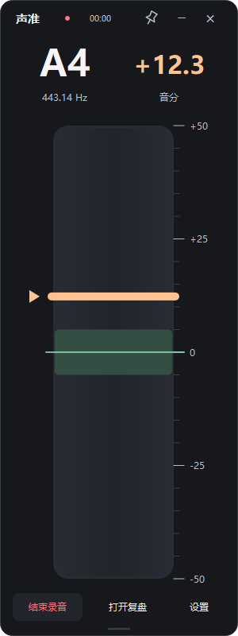
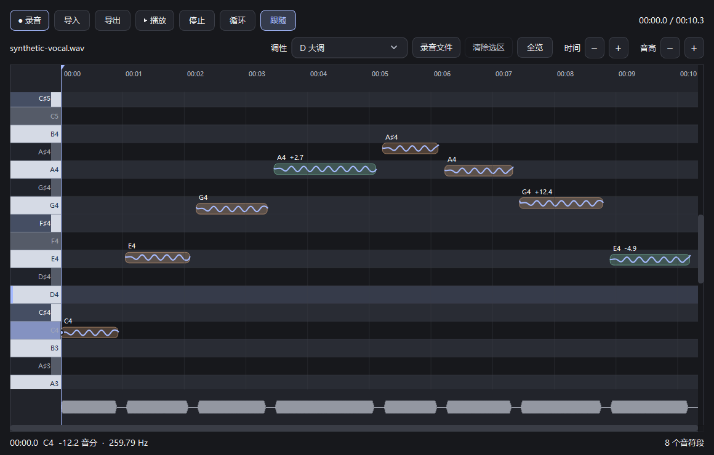

# 声准 · Vocal Pitch

Windows 声乐音准测量与录音复盘工具。实时显示音名、频率和正负音分，使用钢琴卷帘查看录音中的音高变化。

## 下载使用

在 [Releases](https://github.com/NonoKing123456/vocal-pitch/releases) 下载 Windows x64 压缩包，解压后运行 `声准.exe`，并保留同目录的 `_internal` 文件夹。无需安装 Python，音频处理全部在本机完成。

## 功能

- 实时音准条：整条只覆盖一个半音（−50～+50 音分），显示音名、频率和音分。
- 在小窗口直接录音，结束后自动打开复盘；录音时继续显示实时音准。
- 钢琴卷帘：连续音高曲线、音符段、波形、同步回放、选区循环及横纵缩放。
- 调性自动估计，支持手动选择 12 个大调和 12 个小调，调内音高亮。
- Flat／Sharp 音名切换、A4 基准、输入设备、门限和准音范围设置。
- 六套配色，右上角图钉置顶，主窗口等比例缩放。
- 导入 WAV、FLAC、OGG、MP3，导出 24 位 WAV。





## 操作

| 操作 | 功能 |
| --- | --- |
| 小窗口「录音」／R | 开始或结束录音 |
| 小窗口「打开／关闭复盘」／V | 显示或隐藏复盘窗口，保留当前数据 |
| 复盘窗口空格 | 播放／暂停 |
| 横向滚轮、Shift＋滚轮、侧键＋滚轮 | 左右移动 |
| Ctrl＋Shift＋左键拖动 | 平移视图 |
| Ctrl＋Alt＋拖动／滚轮 | 缩放视图 |
| 拖动滚动条两端 | 缩放对应轴 |
| 双击滚动条 | 对应轴全览 |
| Ctrl＋Alt＋双击音符／编辑背景 | 放大音符／恢复视图 |

详细用法见 [使用说明](使用说明.md)。

## 从源码运行

推荐 Windows 10/11 x64、Python 3.13。

```powershell
git clone https://github.com/NonoKing123456/vocal-pitch.git
cd vocal-pitch
python -m venv .venv
.\.venv\Scripts\python.exe -m pip install -r requirements.txt
.\.venv\Scripts\python.exe app.py
```

构建单文件 EXE：

```powershell
.\build.ps1
```

输出为 `release\声准.exe`，运行 `install.ps1` 可安装到当前用户目录并添加桌面入口。

构建公开分发的便携目录包：

```powershell
.\build.ps1 -Portable
.\.venv\Scripts\python.exe package_release.py
```

便携包保留可替换的动态库，并附带第三方许可与源码获取说明。打包器不会包含个人设置、录音、开发环境或测试产物。

## 验证

```powershell
.\.venv\Scripts\python.exe -m unittest test_pitch test_devices test_recording test_tonality -v
.\.venv\Scripts\python.exe test_audio_pipeline.py
.\.venv\Scripts\python.exe verify_ui.py
.\.venv\Scripts\python.exe verify_recording_ui.py
.\.venv\Scripts\python.exe verify_workflow_navigation.py
```

`verify_audio_hardware.py` 会使用当前选择的麦克风做一次短录音及静音播放检查，手动需要时再运行。其他测试采用合成信号或模拟音频设备；界面验证会打开测试窗口。

## 精度与数据

实时分析采用 YIN，离线分析采用多候选概率估计与 Viterbi 轨迹选择，保留连续频率。调性采用时长及可信度加权的调性轮廓相关性。

针对清唱或其他单音信号，测量范围 60–1600 Hz。数值显示到 0.1 音分不等于实际准确度；噪声、气声、泛音、颤音、伴奏及声卡时钟均会影响识别。调性自动估计可由手动选择覆盖。

录音仅在主动录制时保存到 `%LOCALAPPDATA%\VocalPitch\Recordings`，设置保存在同目录的 `settings.json`。程序不上传音频。仓库截图来自合成测试信号，不含个人录音。

## 第三方组件

本工具使用 **PySide6／Qt（LGPLv3）**，以及 NumPy、SciPy、sounddevice、SoundFile 等组件。许可、动态库替换方法和对应源码入口见 [THIRD_PARTY_NOTICES.md](THIRD_PARTY_NOTICES.md)，分发包中附有相应许可文本。

项目源码尚未单独指定开源许可证；第三方组件保留各自的许可和权利。
